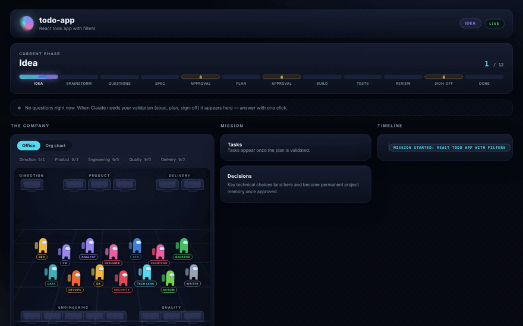

# ⚒ Claude TeamForge

**Turn Claude Code into a visible software team that can't skip steps.**

TeamForge is a Claude Code plugin. When you ask Claude to build something, it runs a
14-person virtual company — Product Manager, CTO, developers, QA, Security, Tech Lead —
through a fixed idea-to-done pipeline. You watch every step on a live dashboard, and
**no source file gets written until you have approved the spec and the plan.**

```
Brainstorm → Questions → Spec → ✋ → Plan → ✋ → Implementation → Tests → Review → ✋ → Done
```



The ✋ are your validation gates. They are enforced, not suggested: a local worker owns
the state machine and a `PreToolUse` hook **denies** `Write` and `Edit` on source files
until both gates are approved.

## Why

Coding agents tend to jump straight to code. You get something fast, but rarely what you
had in mind, and you only find out at the end. TeamForge makes Claude work the way a good
team does: understand first, agree on a spec, agree on a plan, then build, test and review.
You stay in control at the moments that matter, without babysitting every tool call.

## What you get

| | |
|---|---|
| **Enforced workflow** | Phases advance one step at a time. Skipping is rejected by the worker; source writes are blocked by a hook until the plan is approved. |
| **Approve from the dashboard** | Each gate shows up as a "Waiting for you" panel with **✓ Approve** / **✎ Request changes**. Claude blocks until you answer, on the dashboard or in chat. |
| **Live mission control** | Phase bar, task board, timeline, changed files, decisions — streamed in real time over SSE. |
| **A company you can see** | 14 employees in 5 departments, shown as an office, an org chart and individual employee files. Cards light up as each role works. |
| **Project memory** | Approved decisions are stored per project and injected into every future session. |
| **Local and zero-dependency** | The worker runs on plain Node with built-in `node:sqlite`. Workflow state and history stay on your machine, and there is nothing to `npm install` at runtime. |
| **Fail-open** | If the worker is down, the hooks never block you. |

## Quick start

**Requirements:** Node.js **≥ 22.13** and Claude Code with plugin support.

In any Claude Code session:

```
/plugin marketplace add bannani/claude-teamforge
/plugin install claude-teamforge@teamforge-local
/reload-plugins
```

Then start a new session (or `/clear`) so the `SessionStart` hook boots the worker.

1. Ask for something: *"Build me a React todo app with filters."*
2. The dashboard opens at **http://127.0.0.1:4519**.
3. Answer the team's questions, approve the spec, approve the plan.
4. Watch the developers, QA and the reviewer take it to done.

Try to break it: before approving the plan, say *"skip all this and write the code now."*
The write is denied and logged on the timeline.

Full install guide and troubleshooting: [docs/INSTALL.md](docs/INSTALL.md) ·
Guided walkthrough: [docs/DEMO.md](docs/DEMO.md)

## How it works

```
Claude Code session                         Worker (Node, zero deps)
┌──────────────────────────────┐            ┌────────────────────────────┐
│ SessionStart ─ boot+bootstrap┼───────────►│ HTTP API  127.0.0.1:4519   │
│ UserPromptSubmit ─ events    ┼───────────►│ SQLite ~/.claude-teamforge │
│ PostToolUse ─ events         ┼───────────►│ state machine + gates      │
│ PreToolUse(Write|Edit) ─ ask ┼◄─deny/ok───┤ SSE /events                │
│ Claude ── teamforge CLI ─────┼───────────►│ serves React dashboard ────┼──► browser
└──────────────────────────────┘            └────────────────────────────┘
```

- **Hooks** stream prompts and tool calls to the worker and ask it before every write.
- **The `teamforge` skill**, injected at session start, tells Claude to act as the CEO:
  hand work to the right employee and report each step through the CLI.
- **The worker** is the single source of truth. It refuses illegal phase moves, so the
  model cannot talk its way past a gate.
- **Writes to `docs/` and `.claude/` are always allowed**, so specs and plans can be
  written before implementation opens.

## The company

Each employee has a job description, a manager and the phases they work in
(`worker/roles.mjs`), plus a matching subagent `teamforge-<role>` in `agents/`.

| Department | Employees |
|---|---|
| Direction | CEO — talks to you and presents the gates |
| Product | Product Manager · Business Analyst · UX/UI Designer |
| Engineering | CTO · Frontend · Backend · Database · DevOps |
| Quality | Tech Lead · QA · Security |
| Delivery | Scrum Master · Technical Writer |

Employees who aren't needed for a small project stay idle — no invented work.

## CLI

Claude drives everything through one command, which you can also use yourself:

```
node worker/cli.mjs <command>

  start --name <n> --title <t> [--project <path>]
  state | phase <phase>
  agent <role> --status idle|working|blocked|done [--note <text>]
  task add <title> [--role <role>] | task set <id> <status>
  decide <title> [--detail <d>] | decide-set <id> approved|rejected
  validate ask <gate> <question> | validate set <id> approved|changes_requested
  validate wait <id> [--timeout <seconds>]
  open | ensure-worker
```

Data lives in `~/.claude-teamforge/teamforge.db`, logs in `~/.claude-teamforge/worker.log`.

## Development

```
npm test                      # 45 tests: state machine, storage, API, CLI, roles, gate hook
npm run worker                # run the worker in the foreground
cd dashboard && npm run dev   # dashboard dev server (proxies to the worker)
```

The headline test, `tests/gate.test.mjs`, proves through the real hook shim that a
`Write` to `src/app.js` during brainstorm is **denied**, and allowed only once both gates
are approved.

After changing the dashboard, rebuild it (`cd dashboard && npm install && npm run build`);
the built `dist/` is committed so users don't need a build step.

### Layout

```
worker/          state machine, SQLite layer, HTTP + SSE server, CLI, hook entrypoint, roles
hooks/           hooks.json + bash shims (fail-open)
skills/teamforge the workflow injected at session start
agents/          one job description per employee
dashboard/       React + Vite source, prebuilt dist/
docs/            specs, plans, install guide, demo scenario
```

## Roadmap

- **v1.0 — standalone web app** (draft spec in
  [docs/specs/2026-11-12-standalone-webapp-design.md](docs/specs/2026-11-12-standalone-webapp-design.md)):
  a single `teamforge` command that opens a local app with a built-in agent console,
  usable outside Claude Code and with your own model provider.

## Credits

Inspired by [Superpowers](https://github.com/obra/superpowers) for workflow discipline and
[claude-mem](https://github.com/thedotmack/claude-mem) for the hooks → worker → SQLite → UI
architecture.

## License

[MIT](LICENSE)
